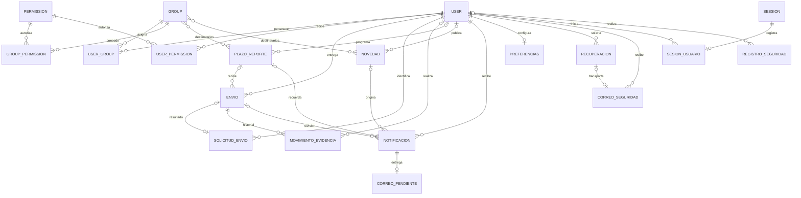

# Modelo de datos de GESICOM

Las migraciones de cada aplicación son la definición del esquema. No se mantiene un segundo archivo de creación de tablas: `python manage.py migrate --settings=SENNOVA.migration_settings` construye o actualiza MySQL con la cuenta dedicada, conservando los registros. El índice de correos normalizados se añade mediante migración SQL porque admite varias cuentas de mantenimiento sin dirección.

| Área | Tablas principales | Integridad y consulta |
| --- | --- | --- |
| Identidad | `auth_user`, `auth_group`, `auth_user_groups` | Correo normalizado único; contraseñas con hash; permisos de Django |
| Permisos | `auth_permission`, `auth_group_permissions`, `auth_user_user_permissions` | Tablas nativas de Django; actualización transaccional por grupo y revisión calculada, sin tablas duplicadas |
| Evidencias | `Gesicom_envio` | Propietario y plazo con claves foráneas; estados compatibles; índices por usuario, proyecto, estado, fecha, plazo/usuario/primera entrega y nombre de archivo |
| Recibos de alta | `Gesicom_solicitudenvio` | UUID primario; propietario obligatorio; relación única opcional con la evidencia; conserva un recibo sin destino al eliminar la evidencia |
| Historial de evidencia | `Gesicom_movimientoevidencia` | Actor opcional; unicidad por evidencia/versión; orden cronológico por versión |
| Agenda | `notificaciones_plazoreporte` y tabla intermedia de grupos | Índice de activo/fecha; revisión de edición y versión de avisos; cada envío conserva el límite aplicado |
| Publicaciones | `notificaciones_novedad` y grupos | Autor opcional; destinatarios por rol o toda la comunidad |
| Bandeja | `notificaciones_notificacion` | Índice por usuario/lectura/fecha; unicidad por destinatario y publicación o fase del plazo |
| Entrega | `notificaciones_correopendiente` | Un correo por aviso; índice de estado/próximo intento, arrendamiento de trabajo y cancelación de avisos obsoletos |
| Preferencias | `notificaciones_preferenciasnotificacion` | Una configuración por usuario |
| Recuperación | `cuentas_passwordresettoken` | Hash del PIN, caducidad, intentos y firma que lo vincula con las credenciales |
| Correo de seguridad | `cuentas_correoseguridad` | PIN cifrado hasta su envío; contenido borrado al terminar; índice de procesamiento |
| Sesiones | `django_session`, `cuentas_sesionusuario` | Registro individual enlazado por clave foránea; revocación de caché y base de datos |
| Auditoría | `cuentas_registroseguridad` | Actor opcional, acción, fecha y ruta; no guarda contraseñas ni peticiones completas |

`Gesicom_rol` e `Gesicom_instructorprofile` pertenecen al esquema histórico. Se conservan para mantener compatibilidad; la autorización actual utiliza los grupos de Django. No se duplican sus registros ni se añaden nuevos paneles basados en esas tablas.

La desactivación de una cuenta revoca sus sesiones e invalida sus recuperaciones antes de permitir una futura reactivación. Las operaciones masivas admiten hasta 100 cuentas, bloquean las filas en orden y validan todo el lote antes de modificarlo. El cambio de contraseña utiliza los validadores oficiales de Django con el usuario como contexto.

Cada evidencia tiene una versión creciente y una fecha de última actualización. La migración 0013 incorpora el estado de los registros previos con actor desconocido, manteniendo sus fechas originales. El historial no contiene contraseñas ni copias de los adjuntos.

El recordatorio adicional usa el tipo `seguimiento` y la unicidad existente de usuario/plazo/versión/tipo. No requiere una tabla duplicada. El cumplimiento se calcula con subconsultas `EXISTS` e índices; los listados de personas se paginan y no cargan la totalidad de evidencias.

La migración `Gesicom.0015_solicitudes_adjuntos` añade el índice de archivo y los recibos de alta sin alterar datos existentes. El recibo se crea únicamente al aceptar un formulario identificado, en la misma transacción que su evidencia y movimiento. No guarda el formulario, la firma, archivos ni credenciales. No tiene permisos predeterminados ni panel propio. Al eliminar la cuenta desaparecen sus recibos; al eliminar solo una evidencia se conserva el UUID para impedir que un reintento la recree. Los archivos se retiran después del commit y únicamente cuando no quedan referencias a su nombre.
