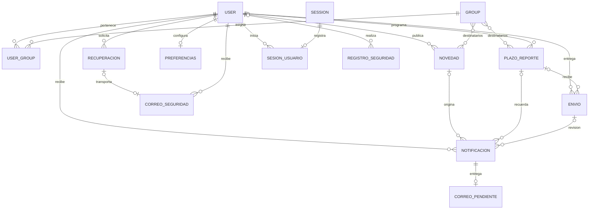

# Modelo de datos de GESICOM

Las migraciones de cada aplicación son la definición del esquema. No se mantiene un segundo archivo de creación de tablas: `python manage.py migrate` construye o actualiza MySQL conservando los registros. El índice de correos normalizados se añade mediante migración SQL porque admite varias cuentas de mantenimiento sin dirección.

| Área | Tablas principales | Integridad y consulta |
| --- | --- | --- |
| Identidad | `auth_user`, `auth_group`, `auth_user_groups` | Correo normalizado único; contraseñas con hash; permisos de Django |
| Evidencias | `Gesicom_envio` | Propietario y plazo con claves foráneas; estados compatibles; índices por usuario, proyecto, estado y fecha |
| Agenda | `notificaciones_plazoreporte` y tabla intermedia de grupos | Índice de activo/fecha; versión del plazo; cada envío conserva el límite aplicado |
| Publicaciones | `notificaciones_novedad` y grupos | Autor opcional; destinatarios por rol o toda la comunidad |
| Bandeja | `notificaciones_notificacion` | Índice por usuario/lectura/fecha; unicidad por destinatario y publicación o fase del plazo |
| Entrega | `notificaciones_correopendiente` | Un correo por aviso; índice de estado/próximo intento y arrendamiento de trabajo |
| Preferencias | `notificaciones_preferenciasnotificacion` | Una configuración por usuario |
| Recuperación | `cuentas_passwordresettoken` | Hash del PIN, caducidad, intentos y firma que lo vincula con las credenciales |
| Correo de seguridad | `cuentas_correoseguridad` | PIN cifrado hasta su envío; contenido borrado al terminar; índice de procesamiento |
| Sesiones | `django_session`, `cuentas_sesionusuario` | Registro individual enlazado por clave foránea; revocación de caché y base de datos |
| Auditoría | `cuentas_registroseguridad` | Actor opcional, acción, fecha y ruta; no guarda contraseñas ni peticiones completas |

`Gesicom_rol` e `Gesicom_instructorprofile` pertenecen al esquema histórico. Se conservan para mantener compatibilidad; la autorización actual utiliza los grupos de Django. No se duplican sus registros ni se añaden nuevos paneles basados en esas tablas.

La desactivación de una cuenta revoca sus sesiones e invalida sus recuperaciones antes de permitir una futura reactivación. Las operaciones masivas admiten hasta 100 cuentas, bloquean las filas en orden y validan todo el lote antes de modificarlo. El cambio de contraseña utiliza los validadores oficiales de Django con el usuario como contexto.
